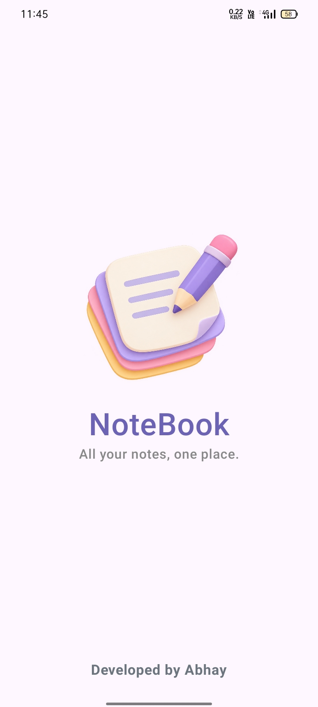
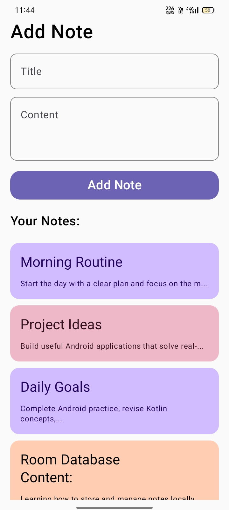
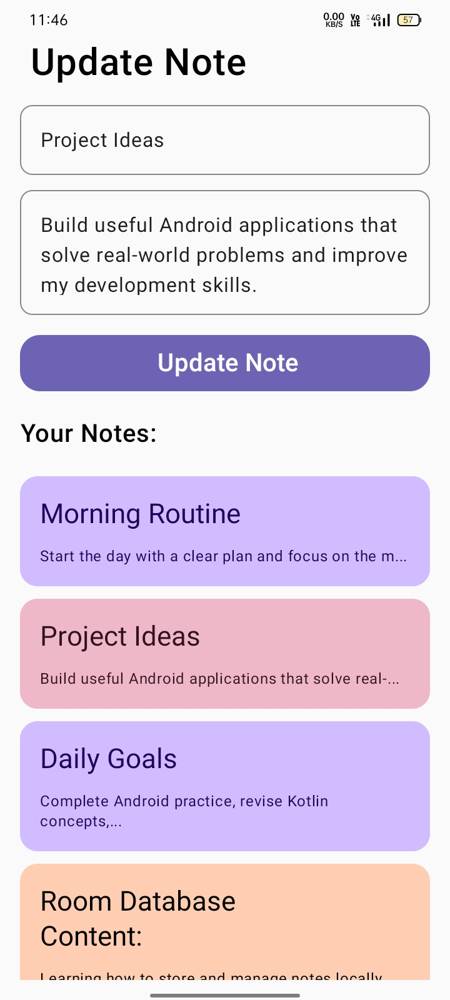

# NoteBook 📝

A modern Notes App built with Kotlin, Jetpack Compose, Room Database, and MVVM.

## ✨ Features

- Create and save notes
- View note details
- Edit existing notes
- Delete notes
- Local data storage using Room Database
- Clean and simple Jetpack Compose UI

## 🛠️ Tech Stack

- Kotlin
- Jetpack Compose
- Room Database
- MVVM Architecture
- Android Studio

## 📱 Screenshots

<table>
  <tr>
    <td align="center">
      <b>Splash Screen</b>  
      
    </td>
    <td align="center">
      <b>Home & Add Note</b>  
      
    </td>
  </tr>
  <tr>
    <td align="center">
      <b>Note Details</b>  
      
    </td>
    <td align="center">
      <b>Edit & Update</b>  
      
    </td>
  </tr>
</table>
